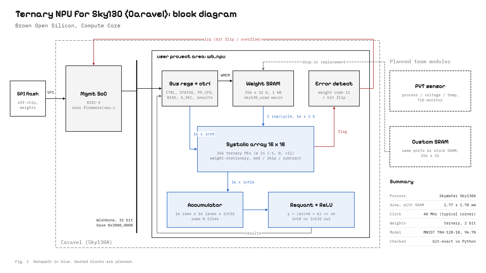
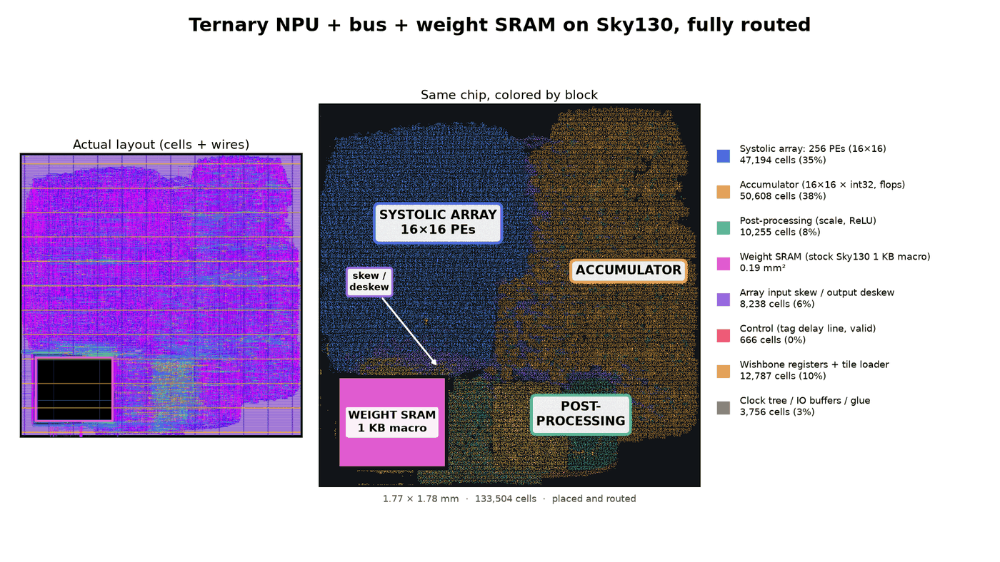

# 8-bit-quant: ternary AI accelerator on Sky130

An open-source neural-network accelerator (NPU) whose weights are only **-1, 0, +1**, so it adds and
subtracts instead of multiplying. It targets SkyWater 130 nm through ChipFoundry chipIgnite (Caravel)
and is built to tolerate radiation-style bit flips. Brown Open Silicon.



**New here? Start with [CONTRIBUTING.md](CONTRIBUTING.md).**

| Doc | What |
|---|---|
| [CONTRIBUTING.md](CONTRIBUTING.md) | First task, how to submit work |
| [docs/setup.md](docs/setup.md) | Install (macOS, Windows, Linux), VNC, tests, troubleshooting |
| [docs/architecture.md](docs/architecture.md) | How the chip works, block by block, plus the register map |
| [docs/interfaces.md](docs/interfaces.md) | Specs for the blocks other teams plug in (PVT sensor, SRAM, Caravel) |
| [docs/glossary.md](docs/glossary.md) | PE, MAC, systolic, PDK, DRC... in plain words |
| [docs/radiation.md](docs/radiation.md) | What radiation does to each block, what protects it, what to build next |

## Status

| | |
|---|---|
| RTL (16x16 array, accumulator, requant, bus, SRAM buffer) | done, all tests pass |
| MNIST 784-128-10, ternary, integer-only | 96.70% accuracy; RTL matches Python bit-for-bit |
| C firmware for Caravel's RISC-V CPU | done, tested against the RTL |
| Place and route to GDS (LibreLane, Sky130) | done: 1.79 x 1.81 mm, 180k cells + 1 KB SRAM |
| Timing, 40 MHz typical corner | met (+6.9 ns) |
| Timing, 40 MHz slow corner (ss, 100 C, 1.6 V) | **fails** (-8.7 ns setup, small hold misses) |
| Routing DRC / antenna | 16 / 0 |
| DRC + LVS sign-off, Caravel wrapper, precheck | not started |
| PVT sensor, custom SRAM (other teams) | in design, see [interfaces](docs/interfaces.md); ring oscillator simulated ([analog/ring_osc](analog/ring_osc/README.md)) |



## Quick start

```bash
make quant   # train, quantize, fault-inject, export golden vectors  (~10 s, needs uv)
make sim     # all RTL tests in the EDA container                    (a few min, needs Docker)
make area    # synthesize to Sky130 cells (PDK=gf180mcuD for GF180)
make shell   # shell inside the EDA container
```

## Key results

| Weights | Memory | Clean acc | Acc at 1% bit flips |
|---|---|---|---|
| int8 | 99.2 KB | 96.6% | 92.6% |
| ternary, rounded after training | 24.8 KB | 78.1% | 76.2% |
| **ternary, quantization-aware training** | **24.8 KB** | **96.7%** | **96.4%** |

| Block (synthesized, Sky130) | Area |
|---|---|
| one int8 MAC vs one ternary PE | 5,907 vs 2,233 um^2 (2.6x smaller) |
| 16x16 ternary array | 0.41 mm^2 (GF180: 1.26) |
| accumulator (16 x 16 x int32, flip-flops) | 0.39 mm^2 |
| full NPU with bus | 0.99 mm^2 + 0.19 mm^2 SRAM |

Caveats: MNIST is a placeholder workload. The fault model is random flips in stored weights only, with 5 trials.

## Repo map

| Path | What |
|---|---|
| `quant/` | Python model, quantization, bit-flip injection, golden-vector export |
| `rtl/` | SystemVerilog: `pe_ws_ternary`, `array_ternary`, `accum_buf`, `postproc`, `core_ternary`, `wb_npu` |
| `rtl/macros/` | Sky130 SRAM model + black box (OpenRAM, Apache-2.0) |
| `tb/` | cocotb tests, golden vectors, `npu_driver.py` (Python reference firmware) |
| `firmware/` | C driver for Caravel's CPU |
| `synth/`, `pnr/` | yosys area script; LibreLane configs and layout renderers |
| `analog/ring_osc/` | xschem + ngspice ring oscillator, the PVT sensor starting point |
| `scripts/eda.sh` | runs any command inside the EDA container |
| `third_party/coralnpu` | Google Coral NPU, reference only (`make coral`) |
