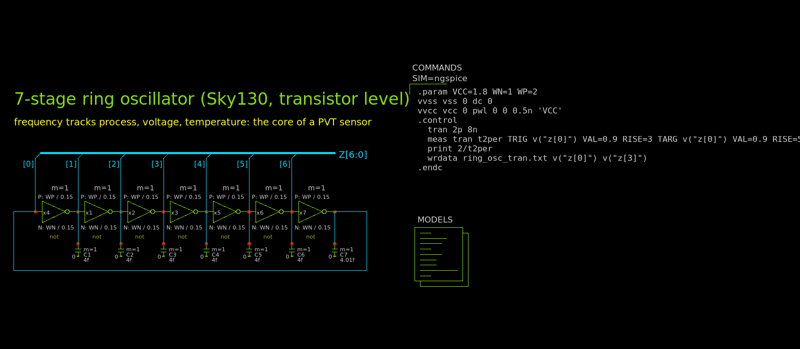
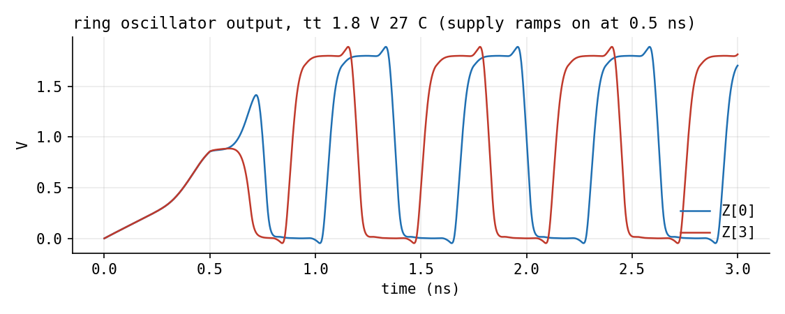
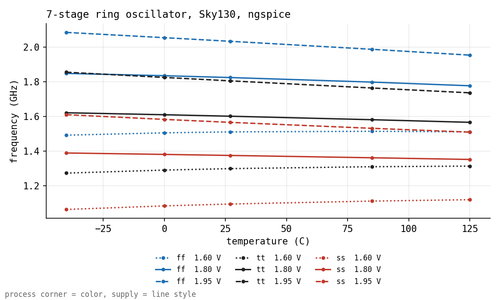

# Ring oscillator (PVT sensor starting point)

TLDR: 7 inverters in a loop oscillate at about 1.6 GHz on Sky130. The frequency shifts with process, voltage,
and temperature, which is what a PVT sensor measures. Starting point for the sensor team.



```bash
scripts/eda.sh "python3 analog/ring_osc/sweep.py"   # xschem netlist -> ngspice PVT sweep -> plots (~1 min)
```

To edit it, open `ring_osc.sch` in xschem (VNC desktop, see [CONTRIBUTING](../../CONTRIBUTING.md)).




## What the sweep shows (3 corners x 3 supplies x 5 temperatures)

| Change | Frequency effect |
|---|---|
| Process: ss / tt / ff at 1.8 V, 27 C | 1.38 / 1.60 / 1.82 GHz (about +-14%) |
| Supply: 1.6 / 1.8 / 1.95 V at tt, 27 C | 1.30 / 1.60 / 1.81 GHz (about 1.5 GHz per volt) |
| Temperature: -40 to 125 C at tt, 1.8 V | 1.62 to 1.57 GHz (only -3%) |

Takeaways for the sensor design:

- One ring oscillator mostly measures **voltage and process**, and barely measures temperature.
- At 1.6 V, frequency goes *up* with temperature, while at 1.8 V it goes down (temperature inversion).
  So the temperature slope depends on the supply.
- To separate P, V, and T, use several oscillators with different sensitivities and compare them.
  For example: different transistor types (LVT, HVT), different lengths, or a supply-independent current-starved oscillator.
- 1.6 GHz is too fast to count directly at 40 MHz. Divide it first, or add stages.

Limits: this is schematic level, with ideal 4 fF loads and no layout parasitics. Inverter netlist from the PDK's
xschem examples (`sky130_tests/not.sym`).
