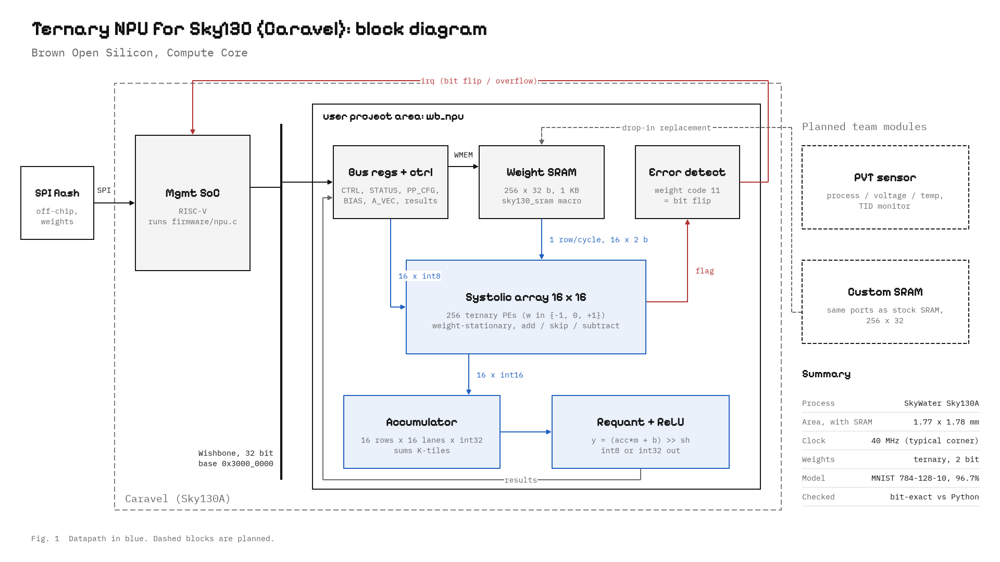
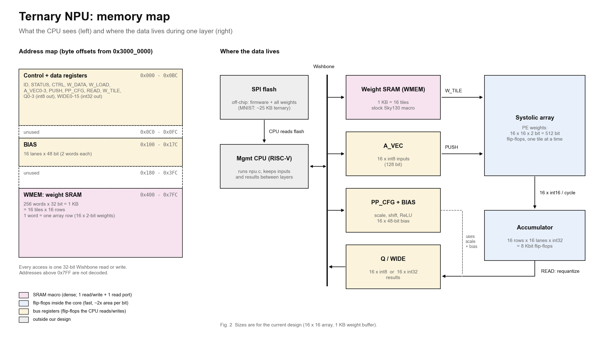
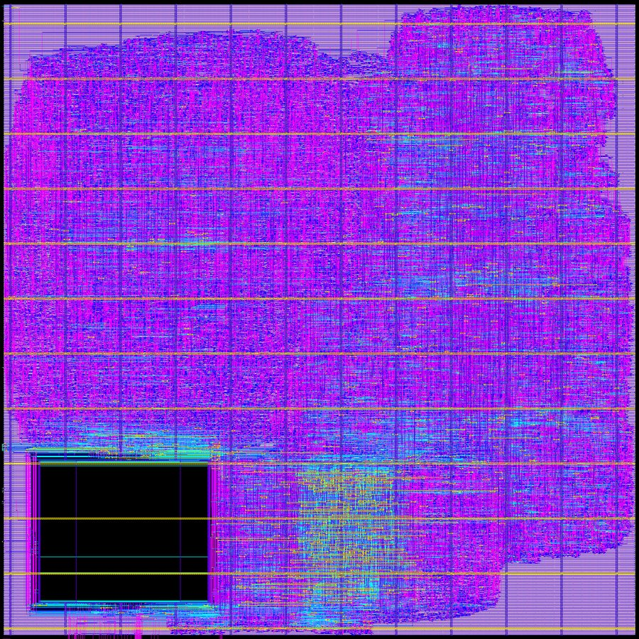
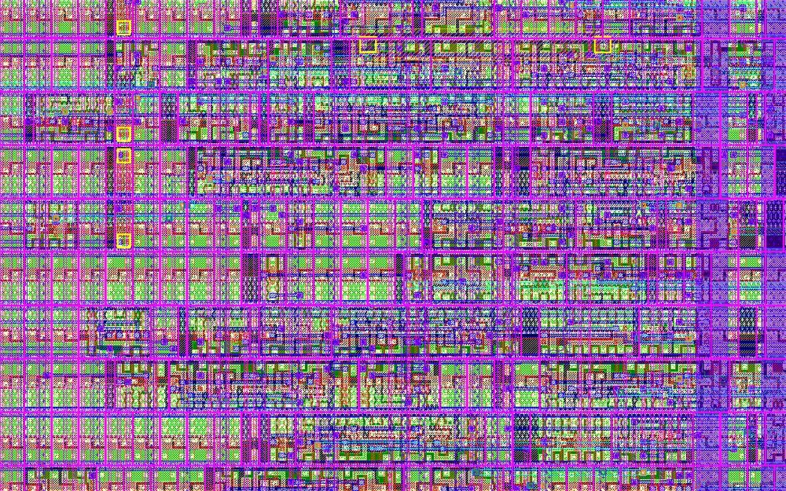
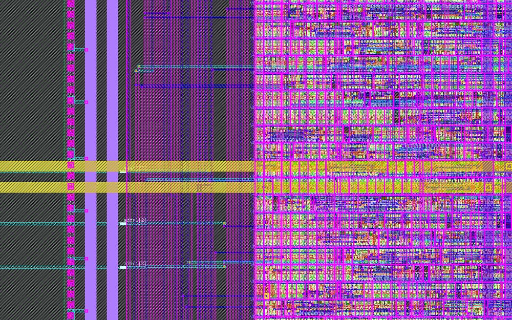

# Architecture

TLDR: the CPU writes weights and inputs over the bus. A 16x16 grid of tiny adders multiplies a
16-input slice by a 16x16 weight tile. An accumulator sums the slices. Post-processing scales the
sum back down to int8. The CPU reads the result.



## Data flow, one dense layer

```
CPU --Wishbone--> wb_npu registers / weight SRAM
                      |
                      v
   int8 inputs --> [skew] --> 16x16 ternary array --> [deskew] --> int16 partial sums
                                (weights held)                          |
                                                                        v
                               accumulator (16 rows x 16 lanes x int32, sums K-tiles)
                                                                        |
                                                                        v
                               postproc: y = (acc*m + bias) >> sh, round, ReLU, clamp
                                                                        |
                                                                        v
                                                 int8 (or int32 for the last layer) --> CPU
```

A layer with `n_in` inputs and `n_out` outputs is cut into 16x16 **tiles**:
`ceil(n_in/16)` K-tiles x `ceil(n_out/16)` output groups. MNIST 784-128-10 = 49 x 8 + 8 x 1 = **400 tiles**.
Up to 16 images (the batch) go through each tile while its weights are loaded.

## Blocks

| Block | File | Job | Size (Sky130, synth) |
|---|---|---|---|
| PE | `rtl/pe_ws_ternary.sv` | holds one 2-bit weight; adds, skips, or subtracts the input | 1,394 um^2 |
| Array | `rtl/array_ternary.sv` | 16x16 PEs, weight-stationary systolic; skew/deskew; flags weight code `11` as a bit flip | 0.41 mm^2 |
| Accumulator | `rtl/accum_buf.sv` | int32 per row and lane; `first` overwrites, otherwise adds; 2-stage pipeline with forwarding; sticky overflow | 0.39 mm^2 |
| Postproc | `rtl/postproc.sv` | integer requant + ReLU + clamp, one shared multiplier | 0.075 mm^2 |
| Core | `rtl/core_ternary.sv` | array + accumulator + postproc; `{first, addr}` tags ride a 31-cycle delay line next to the data | 0.86 mm^2 |
| Bus + buffer | `rtl/wb_npu.sv` | Wishbone slave, registers, 1 KB SRAM weight buffer, tile loader, bus stalls | 0.99 mm^2 + 0.19 mm^2 SRAM |

Weight encoding (2 bits): `00` = 0, `01` = +1, `10` = -1, `11` = invalid (bit-flip detected).

## Memory map



## Register map (`wb_npu`, byte offsets from 0x3000_0000)

| Offset | Name | R/W | Meaning |
|---|---|---|---|
| 0x000 | ID | R | `0x4E505531` ("NPU1") |
| 0x004 | STATUS | R | [0] busy [1] any bit-flip error [2] overflow [3] result ready [4] weight code 11 [5] PP_CFG copy flip (TMR-repaired) [6] BIAS parity |
| 0x008 | CTRL | W | [0] clear error/overflow |
| 0x00C | W_DATA | RW | one weight row: 16 x 2-bit, lane n = bits [2n+1:2n] |
| 0x010 | W_LOAD | W | k: load W_DATA into array row k |
| 0x014-0x020 | A_VEC0-3 | RW | 16 int8 inputs, 4 per word |
| 0x024 | PUSH | W | [3:0] accumulator row, [4] first tile: send A_VEC into the array |
| 0x028 | PP_CFG | RW | [15:0] m (signed) [21:16] shift [24] ReLU |
| 0x02C | READ | W | [3:0] row: requantize it into Q / WIDE |
| 0x030 | W_TILE | W | [3:0] t: stream tile t from the weight SRAM into the array (16 cycles) |
| 0x040-0x04C | Q0-3 | R | 16 int8 results |
| 0x080-0x0BC | WIDE0-15 | R | 16 int32 results |
| 0x100-0x17C | BIAS | RW | lane n: 0x100+8n = bits [31:0], 0x104+8n = bits [47:32] |
| 0x400-0x7FC | WMEM | RW | weight SRAM, 256 rows = 16 tiles |

Bus timing: every access acks in 2 cycles (WMEM reads take 3). `W_TILE` and `PUSH` stall the bus until it is safe,
so the CPU never polls between tiles. `irq` = error or overflow.

## Firmware loop

```
for each output group of 16:
    for each chunk of up to 16 K-tiles:
        write the tiles into WMEM
        for each tile t: write W_TILE=t; for each image: write A_VEC0-3, PUSH
    wait until STATUS.busy = 0
    write PP_CFG and BIAS
    for each image: write READ, wait for STATUS.ready, read Q (or WIDE)
```

`firmware/npu.c` (C, for Caravel) and `tb/npu_driver.py` (Python) both implement this. Cost: about 2,600 bus
accesses and 6,100 cycles per MNIST image. Most of that is activations, so a DMA would help.

## Verification

| Test | Checks |
|---|---|
| `test_pe`, `test_array`, `test_accum`, `test_postproc` | each block against Python, including random and edge cases |
| `test_core.full_model_mnist` | whole 784-128-10 network on the core, 32 images bit-exact |
| `test_wb.full_model_bus`, `full_model_wmem` | same network over the bus only, with and without the SRAM buffer |
| `test_wb.sram_bitflip` | a flipped bit in the SRAM gets flagged |
| `test_firmware` | the real C firmware drives the RTL, bit-exact |

## Physical design



Zoomed in on the real GDS in KLayout (`pnr/zoom_gds.py`):

| Standard cells and wiring, about 40 x 25 um | SRAM edge: its pins and halo (left), logic (right) |
|---|---|
|  |  |

`pnr/wb_npu/config.json`, LibreLane on Sky130, 40 MHz target. Latest run: 1.79 x 1.81 mm, 180k cells,
typical corner met, slow corner fails by 8.7 ns. The worst path runs from the latched bus address (`adr_q`) through
the register decode to the 768 BIAS flip-flops. Registering the decoded write enables should fix it.

Flow settings that matter: `CTS_APPLY_NDR: none` (pin access), SRAM black box with power pins (`rtl/macros/*_bb.v`),
`STA_THREADS: 2` and `DRT_THREADS: 4` (memory).

## Design choices

- **Ternary, not int8:** 4x less weight memory, 2.6x smaller PE, and accuracy matches when trained with QAT (BitNet-style).
- **Accumulator in flip-flops, not SRAM:** it reads and writes 512 bits every cycle. The stock SRAM is 32 bits wide,
  so matching it would take 16 macros (about 3 mm^2) vs 0.39 mm^2 of flip-flops.
- **Weights in SRAM:** one row of 16 x 2 bits is exactly one 32-bit word, so the SRAM is a natural fit.
  Flip-flops for the same 1 KB measured 0.37 mm^2 vs 0.19 mm^2.
- **Inference only:** training happens in Python, and the chip only runs the finished model.

Radiation: see [radiation.md](radiation.md) for the per-block threat table and build order.
