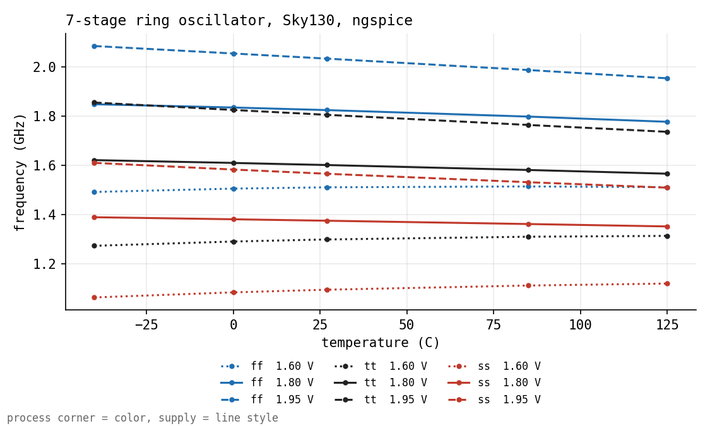

# Interfaces

TLDR: every block talks to Caravel's CPU over the same 32-bit Wishbone bus, at its own address range.
If your block matches the ports below, it plugs in without changes to anyone else's code.

Status: **draft**. Change it by PR, and tag the owners of every block it touches.

## Chip-level plan

```
Caravel management SoC (RISC-V)
        | Wishbone, 32-bit, wb_clk_i (40 MHz target)
        v
user_project_wrapper  (2.92 x 3.52 mm user area)
   |-- address decode (adr[17:16])
   |-- wb_npu          0x3000_0000 - 0x3000_07FF   compute core + 1 KB weight SRAM   (1.79 x 1.81 mm today)
   |-- pvt_sensor      0x3001_0000 - 0x3001_00FF   sensor team
   |-- sram_test       0x3002_0000 - 0x3002_03FF   SRAM team (direct test access to the custom SRAM)
   '-- user_irq[0] = npu irq, user_irq[1] = sensor alert
```

`wb_npu` ignores address bits above [10]. The wrapper must gate `stb`/`cyc` so only one block sees each access.

## Common Wishbone slave port (every block)

| Port | Dir | Width | Meaning |
|---|---|---|---|
| `wb_clk_i` | in | 1 | clock |
| `wb_rst_i` | in | 1 | reset, active high |
| `wbs_stb_i`, `wbs_cyc_i` | in | 1 | access in progress (both high) |
| `wbs_we_i` | in | 1 | 1 = write |
| `wbs_sel_i` | in | 4 | byte enables |
| `wbs_adr_i` | in | 32 | byte address (use the low bits only) |
| `wbs_dat_i` | in | 32 | write data |
| `wbs_ack_o` | out | 1 | one-cycle pulse: access done |
| `wbs_dat_o` | out | 32 | read data, valid with ack |
| `vccd1`, `vssd1` | inout | 1 | 1.8 V and ground, under `ifdef USE_POWER_PINS` |

Rules:

- Ack every access, including ones to unused addresses (read back 0). A missing ack hangs the CPU.
- Offset 0x000 is a read-only ID register with a fixed value, so firmware can check the block is there.
- Registers are 32-bit, word-aligned. Register your outputs. Keep the inputs-to-flip-flop logic short
  (the slow corner is where timing breaks).
- Include a cocotb test in `tb/` and a C header in `firmware/`.

## PVT / radiation sensor (`pvt_sensor`)

Purpose: measure process, voltage, temperature, and total-dose drift on the die, so firmware can tell
whether a bad result came from the environment. It monitors conditions, not data.

Starting point: [analog/ring_osc](../analog/ring_osc/README.md). It's a Sky130 ring oscillator with an xschem
schematic and an ngspice PVT sweep. Its frequency moves about 14% with process and about 15% per 0.15 V, but only
about 3% across -40 to 125 C.



Proposed registers (offsets from 0x3001_0000):

| Offset | Name | R/W | Meaning |
|---|---|---|---|
| 0x00 | ID | R | `0x50565431` ("PVT1") |
| 0x04 | CTRL | RW | [0] enable [1] start one measurement [15:8] which sensor |
| 0x08 | STATUS | R | [0] busy [1] done [2] alert |
| 0x0C | WINDOW | RW | measurement window length, in `wb_clk_i` cycles |
| 0x10 | COUNT | R | ring-oscillator edges counted in the window (frequency, which tracks P, V, T) |
| 0x14 | ALERT_LO / 0x18 ALERT_HI | RW | raise `alert` when COUNT goes outside this range |

Outputs: the Wishbone port above, plus `alert` (wired to `user_irq[1]`).
Analog parts, if any, use Caravel's `analog_io` pins. List them here before layout.

Open questions:
- Which sensors: ring oscillators only, or also an analog temperature or TID element?
- Digital-only (easier to verify and place) or mixed-signal?
- Should `alert` also pause the NPU?

## Custom SRAM (drop-in for the weight buffer)

To replace `sky130_sram_1kbyte_1rw1r_32x256_8` without RTL changes, the macro must match it exactly:

| Port | Dir | Width | Meaning |
|---|---|---|---|
| `clk0` | in | 1 | port 0 clock (read/write port) |
| `csb0` | in | 1 | port 0 select, **active low** |
| `web0` | in | 1 | port 0 write enable, **active low** |
| `wmask0` | in | 4 | byte write mask |
| `addr0` | in | 8 | word address (256 words) |
| `din0` | in | 32 | write data |
| `dout0` | out | 32 | read data |
| `clk1`, `csb1`, `addr1` | in | 1, 1, 8 | port 1 (read-only) |
| `dout1` | out | 32 | port 1 read data |
| `vccd1`, `vssd1` | inout | 1 | power |

Timing: inputs are sampled on the rising clock edge, and `dout` must be valid before the **next** rising edge.
That is one-cycle read latency at 25 ns (40 MHz), at the slow corner (ss, 100 C, 1.6 V).
Both ports may read the same address in the same cycle. Reading and writing the same address at once is not used.

Deliverables (same as the stock macro, see `pnr/wb_npu/config.json` `MACROS`):
GDS, LEF, Liberty `.lib` (tt and ss corners at least), a behavioral Verilog model, and a black-box Verilog with power pins.
Size budget: at most the stock macro's 480 x 398 um, or say how much it saves.

A different depth or width (for example 2 KB) is possible, but tell the RTL owner first. It changes `addr` widths and the tile count.

## Caravel wrapper (`user_project_wrapper`)

Owned by integration. It instantiates the blocks above and does the address decode and IRQs.
Unused `io_*` outputs get tied off with `io_oeb` = 1 (input). It must pass ChipFoundry precheck.
Pin usage beyond Wishbone (logic analyzer, GPIO, `analog_io`) gets listed here before anyone uses it.
