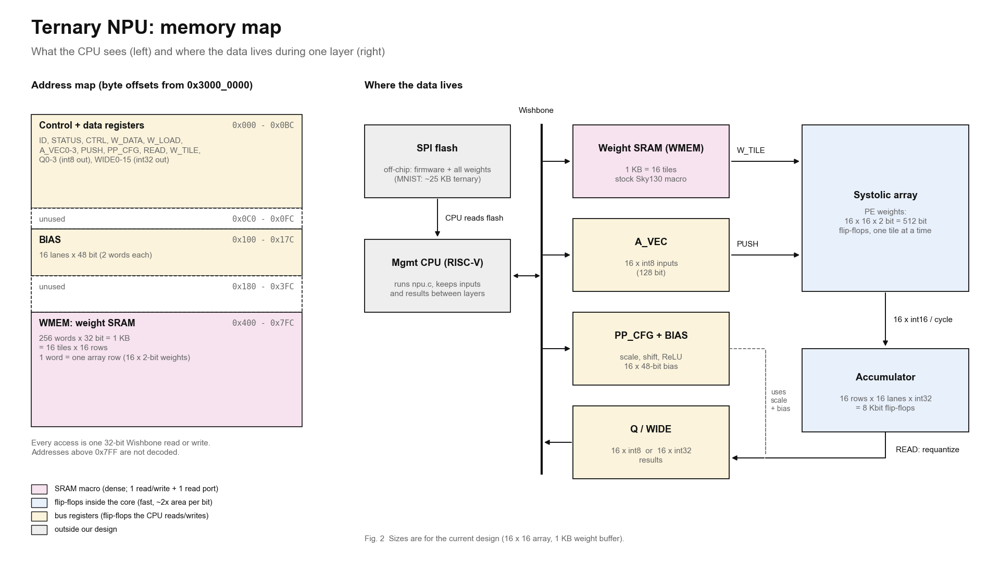

# NPU code



## Purpose
- C code that runs on Caravel's RISC-V CPU and drives the NPU
- CPU is the boss and npu.c holds the instructions to control it
- Talks to the NPU by reading/writing registers
```
*(volatile uint32_t *)(0x30000000 + off) = v;  // write a register
```
- Writing to address 0x3000_0024 (PUSH) (for example) tells the NPU "run these inputs through the array"

## Semantics
- wr()/rd(): read or write 1 register
- npu_present(): read the ID register; NPU should answer w/ 0x4E505531 ("NPU1")
- wait_idle(): loop until STATUS says not busy
- push(): pack 16 int8 inputs into 4 words and PUSH them to the NPU to process them
- configure(): set the weight, bias, ReLU, scale, and shift for post-processing
- nput_dense(): main func that runs whole neural net

```
for each group of 16 outputs:
    copy up to 16 weight tiles into the NPU's SRAM
    for each tile: load it into the array, push every image's inputs through
    wait until done, set scale/bias
    for each image: ask for the result, read it back
```

## Other
- We don't have a chip right now so we're faking it w/ NPU_HOST. Call Python -> cootb turns each test into a real bus cycle on the simulated chip. That's how we proved the C code works against the actual RTL design
